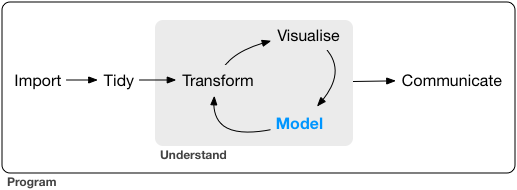

```{r packages_setup, echo=FALSE, message=FALSE, warning=FALSE}
library(tidyverse)
library(patchwork)
knitr::opts_chunk$set(echo = T, warning = F, message = F)
knitr::opts_chunk$set(fig.width=8, fig.height=4.5, fig.retina=3) 
```

class: center, middle, inverse, title-slide

<div class="title-logo"></div>

# Data Analysis and Information Extraction
 
## Topic 4 - Modeling

<br>
<br>
<br>
.pull-left[
### Roi Naveiro
#### Academic Year 2026-2027
]
---
name: project-workflow
## Modeling

```{r project-workflow, echo=FALSE, out.width='100%', fig.align='center', fig.alt='A data analysis project moves from importing and tidying data to a cycle of transforming, visualising and modelling, then communicating results. The Model step is highlighted.'}

```

We have used plots to explore patterns in our data. Now we fit models to describe those patterns and use plots again to see what the models missed.

---
name: modelling-goals
## What do we want a model to tell us?

First-year students are offered an **optional, ungraded practice quiz** a week before their common **final exam** (marked out of 10). Afterwards, only **40 students volunteer** to report their exam mark and whether they took the quiz. These 40 are our **sample**.

1. **Exploratory data analysis (EDA).** Among these 40 volunteers, how do mean exam marks differ between those who took the quiz and those who skipped it?
2. **Inference.** Can we use this sample to estimate the same gap for the **whole population** of first-year students who sat the final exam?
3. **Causality.** Would 15 minutes on the quiz improve final exam marks compared with 15 minutes of usual revision?

Inference and causality each need suitable statistical methods. They also depend on **who enters the sample** and **who decides which students take the quiz**.
---
## EDA in the volunteer sample

Once final exam marks are released, 40 students volunteer for a survey. Each reports whether they took the practice quiz and the mark they received on the final exam.

| Took the practice quiz? | Volunteers | Mean final exam mark (out of 10) |
|:---|---:|---:|
| Yes | 20 | 7.4 |
| No  | 20 | 6.6 |

Among **these 40 volunteers**, those who took the quiz averaged **0.8 points more on the final exam** than those who skipped it (7.4 − 6.6).

.question[Would we see the same gap among everyone who sat the final exam?]
---
## Inference about the whole class

Suppose students who took the quiz were especially likely to volunteer **if they earned a high final exam mark**. Their mean of 7.4 in the survey could exceed the mean for everyone who took the quiz, even with many responses.

How could we estimate the gap for the whole class?

* Draw a **random sample** from the list of everyone who sat the final exam. For each selected student, record quiz participation and the final exam mark.
* Compare the two sample means. A confidence interval based on the sampling design expresses uncertainty about the gap in the class.

.question[Even if we knew the exact gap for the class, would we know how much the quiz helped?]
---
## Did the practice quiz help?

Students who chose to take the quiz may already have studied more. That extra preparation could explain some or all of the gap in final exam marks.

Next year, **randomly assign** students to two revision groups. One spends 15 minutes on the practice quiz. The other spends 15 minutes revising as usual. Both then sit the same final exam.

**Compare mean final exam marks in the two assigned groups.** Random assignment balances prior preparation on average, so the difference estimates the effect of assigning quiz practice to these students.

We now use regression for **exploration**, starting with a pattern in the data we have.
---
name: regression
class: center, middle, inverse

# Models for Exploratory Analysis

---
name: fuel-economy
## How does mpg vary with weight?

Each dot is one of the 32 cars in `mtcars`. We have its weight (`wt`, in thousands of pounds) and its **mpg**, the miles it travels per US gallon.

```{r mpg-scatter, echo=FALSE, out.width="72%", fig.align="center"}
library(tidyverse)
library(modelr)
ggplot(mtcars, aes(wt, mpg)) +
  geom_point() +
  labs(x = "Weight (1,000 lb)", y = "Miles per US gallon (mpg)") +
  theme_minimal()
```

.question[How many fewer mpg would you expect for an extra 1,000 lb?]

---
## What does regression add?

Three cars in our sample weigh exactly 3,440 lb. They get **17.8, 18.7 and 19.2 mpg**. At 3,000 lb, we have no car at all. What mpg should we predict there?

A **regression model** uses the whole sample to estimate how the typical value of one variable changes with another. Here, mpg is our **response** and weight is our **predictor**.

With a straight line we can quantify the change in predicted mpg per 1,000 lb and predict mpg for a 3,000 lb car.

---
## Fitting the line in R

```{r mpg-fit}
library(tidyverse)
library(modelr)

reg_mod <- lm(mpg ~ wt, data = mtcars)
coef(reg_mod)
```

In `mpg ~ wt` the response is on the left and the predictor on the right. Using the estimated intercept and slope, the fitted line is

$$
\widehat{\mathrm{mpg}} = 37.29 - 5.34\,\mathrm{wt}.
$$

---
## How is the line chosen?

```{r mpg-gaps, echo=FALSE, out.width="72%", fig.align="center"}
car_fit <- mtcars %>%
  rownames_to_column("car") %>%
  add_predictions(reg_mod) %>%
  add_residuals(reg_mod)

ggplot(car_fit, aes(wt, mpg)) +
  geom_segment(aes(xend = wt, yend = pred), colour = "grey65") +
  geom_line(aes(y = pred), colour = "#A52A2A", linewidth = 0.9) +
  geom_point() +
  labs(x = "Weight (1,000 lb)", y = "Miles per US gallon (mpg)") +
  theme_minimal()
```

Each vertical segment measures the gap between a car's observed mpg and the line's prediction. **Least squares** chooses the intercept and slope that minimize the sum of these squared gaps.

Using the model for inference requires assumptions about the errors. We set those aside here and use the line to describe these 32 cars.

---
## Interpreting the fitted line

$$
\widehat{\mathrm{mpg}} = 37.29 - 5.34\,\mathrm{wt}.
$$

* **Slope.** One unit of `wt` is 1,000 lb. The heavier of two cars whose weights differ by 1,000 lb is predicted to get **5.34 fewer mpg**. For a 500 lb difference, the predicted gap is half as large.
* **Intercept.** The line predicts **37.29 mpg** at zero weight. Our lightest car weighs 1,513 lb, so this intercept has little practical meaning.

.question[Estimate the mpg for a 3,000 lb car. What would change at 3,500 lb?]

---
## Predicting mpg at a given weight

Enter the new weights in the same units as `wt` in the fitted model.

```{r mpg-newdata}
new_cars <- data.frame(wt = c(3, 3.5))
new_cars$predicted_mpg <- predict(reg_mod, newdata = new_cars)
new_cars
```

The predicted mpg drops from **21.25** to **18.58**, a difference of **2.67 mpg**. Individual cars at either weight may lie above or below the fitted line.

---
## Plotting the fitted values

To reproduce the line, predict at each observed weight and connect the predictions in order of weight.

```{r mpg-grid, out.width="66%", fig.align="center"}
grid <- mtcars %>% data_grid(wt) %>% add_predictions(reg_mod)
ggplot(mtcars, aes(wt, mpg)) +
  geom_point() +
  geom_line(data = grid, aes(y = pred), colour = "#A52A2A") +
  labs(x = "Weight (1,000 lb)", y = "mpg") + theme_minimal()
```

---
name: prediction-residual
## What does one residual tell us?

A **residual** is the vertical distance from the line to the point, including its sign, $e_i=y_i-\hat y_i$. It has the same units as the response.

| Car | Weight (lb) | Observed mpg | Predicted mpg | Residual (mpg) |
|:---|---:|---:|---:|---:|
| Mazda RX4 | 2,620 | 21.00 | 23.28 | −2.28 |
| Toyota Corolla | 1,835 | 33.90 | 27.48 | +6.42 |

The Mazda gets **2.28 fewer mpg** than predicted, so the line overpredicts its mpg. The Corolla gets **6.42 more mpg** than predicted, so the line underpredicts its mpg.

---
## Drawing the residual plot

Keep weight on the horizontal axis. On the vertical axis, replace each car's observed mpg with its residual. A car lying on the fitted line now appears at zero.

```{r mpg-residual-code, fig.keep="none"}
car_fit <- mtcars %>%
  rownames_to_column("car") %>%
  add_residuals(reg_mod)

resid_plot <- ggplot(car_fit, aes(wt, resid)) +
  geom_hline(yintercept = 0, colour = "grey60") +
  geom_point() +
  labs(x = "Weight (1,000 lb)", y = "Observed − predicted mpg") +
  theme_minimal()
resid_plot
```

---
## Reading the residual plot

```{r mpg-residual-plot, echo=FALSE, fig.align="center", out.width="78%"}
marked <- car_fit %>%
  filter(car %in% c("Mazda RX4", "Toyota Corolla")) %>%
  mutate(label_x = if_else(car == "Mazda RX4", 1.85, 3.2),
         label_y = if_else(car == "Mazda RX4", -4.0, 6.4))
resid_plot +
  geom_segment(data = marked, aes(xend = label_x, yend = label_y),
               colour = "#006975", linewidth = 0.4) +
  geom_point(data = marked, colour = "#006975", size = 2.4) +
  geom_label(data = marked, aes(x = label_x, y = label_y, label = car),
             colour = "#006975", label.size = 0, size = 3.5)
```

Near zero, the prediction is close. Farther away, the error is larger. Read from left to right. **At which weights does the line consistently underpredict or overpredict mpg?**

---
## What pattern did the line miss?

| Weight range | Where are the dots? | What did the line do? |
|:---|:---|:---|
| Below 2,300 lb | All 6 above zero | Predicted too few mpg |
| 3,400–3,800 lb | 9 of 10 below zero | Usually predicted too many mpg |
| Above 5,000 lb | All 3 above zero | Predicted too few mpg |

If the line described the average pattern well, we would expect a band scattered around zero across the weight range. Here the residuals tend to rise at the ends and fall in the middle. A single slope misses some of the shape.

Only three cars weigh more than 5,000 lb. More observations at that end would help us judge how general the pattern is.

---
name: salary
## Teachers' salaries

The `teacher` data record each teacher's base salary in dollars, years of experience and highest degree. The two degrees are a master's (MA) and a bachelor's (BA).

```{r}
library(openintro)
library(broom)
data("teacher")
teacher <- teacher %>%
  mutate(degree = factor(degree, levels = c("MA", "BA")))
```

.question[Start with experience alone. Fit `base ~ years` and predict the salary for a teacher with 15 years of experience.]
---
## Salary and years of experience

```{r, out.width="70%"}
fit_years <- lm(base ~ years, data = teacher)
ggplot(teacher, aes(x=years, y=base)) + geom_point() +
  geom_smooth(method="lm", color='red', se=FALSE) + theme_minimal()
```
---
## Salary and years of experience

```{r}
tidy(fit_years) %>% select(term, estimate)
predict(fit_years, newdata = data.frame(years = 15))
```

Each additional year of experience is associated with about **&#36;803 more** in predicted base salary. The prediction for 15 years is about **&#36;55,715**.
---
## Using degree as a predictor

What salary would we predict if all we knew about a teacher was their degree? Fit one mean salary for each group.

```{r}
mod_base_degree <- lm(base ~ degree, data = teacher)
tidy(mod_base_degree) %>% select(term, estimate)
```

We put MA first in `levels`, so R uses it as the **reference group**. The row labelled `degreeBA` gives the difference **BA minus MA**.
---
## From coefficients to salaries

Let $D_{\rm BA}$ be 1 for a BA teacher and 0 for an MA teacher. The fitted salary in dollars is $56{,}609.56 - 352.46\,D_{\rm BA}$.

| Degree | Indicator | Calculation | Predicted salary |
|:---|:---:|:---|---:|
| MA | 0 | $56{,}609.56 - 352.46 \times 0$ | &#36;56,609.56 |
| BA | 1 | $56{,}609.56 - 352.46 \times 1$ | &#36;56,257.10 |

The intercept is the **MA mean salary**. The minus sign tells us that the **BA mean salary is &#36;352.46 lower** in these data.
---
## Choosing the reference group

Suppose we choose BA first instead. The starting salary is now the BA mean, **&#36;56,257.10**. Moving from BA to MA **adds &#36;352.46**.

```{r}
teacher_ba <- teacher %>% mutate(degree = relevel(degree, ref = "BA"))
tidy(lm(base ~ degree, data = teacher_ba)) %>% select(term, estimate)
```

With three degree levels, R reports an intercept for the reference group and **two differences**, one for each other group. In general, $k$ levels give $k-1$ differences.
---
## The two group means

```{r, out.width="68%"}
grid <- teacher %>% data_grid(degree) %>% add_predictions(mod_base_degree)
ggplot(teacher, aes(degree, base)) + geom_point() +
  geom_point(data = grid, aes(y = pred), colour = "red", size = 4) +
  theme_minimal()
```

Each black point is a teacher's salary. Each red point is that group's mean.
---
## Two ways to compare degrees

The BA teachers have **17.1 years** of experience on average. The MA teachers have **14.4 years**.

* `base ~ degree` compares the two groups **as we found them**, with their different mixes of experience.
* `base ~ years + degree` lets us compare a BA and an MA teacher **at the same number of years**.

.question[If salary typically rises with experience, how might the extra experience of the BA group affect the raw difference?]
---
## Salary, experience and degree

Fit a multiple regression with one numerical predictor and one categorical predictor.

```{r}
fit_salary <- lm(base ~ years + degree, data = teacher)
tidy(fit_salary) %>% select(term, estimate)
```

We can now change one predictor at a time when calculating a fitted salary.
---
## Reading the three coefficients

The fitted salary in dollars is approximately
$$
44{,}838 + 818 \times \mathrm{years} - 2{,}560 \times D_{\rm BA}.
$$

* **Intercept.** Set years and the indicator to zero. The model predicts **&#36;44,838** for an MA teacher with no experience.
* **Years.** For two teachers with the **same degree**, one extra year corresponds to **&#36;818 more** in predicted salary.
* **Degree.** For two teachers with the **same experience**, the model predicts **&#36;2,560 less** for BA than for MA.
---
## Compare two teachers at 15 years

```{r}
cases <- tibble(years = c(15, 15), degree = c("MA", "BA"))
cases %>% add_predictions(fit_salary)
```

Both predictions include 15 years of experience. Switching the indicator from 0 to 1 takes the fitted salary from **&#36;57,108** for MA to **&#36;54,548** for BA.

.question[At five years of experience, what gap would this model predict?]
---
## A grid for both groups

Use a common grid of years and predict for each degree.

```{r}
grid <- teacher %>% 
  data_grid(years, degree) %>% 
  add_predictions(fit_salary)
head(grid, 4)
```
---
## Reading the fitted lines

```{r, out.width="68%"}
ggplot(teacher, aes(years, base, colour = degree)) +
  geom_point() + geom_line(data = grid, aes(y = pred)) + theme_minimal()
```

At **any fixed year**, the vertical gap is about **&#36;2,560**. The lines are parallel because both degree groups have the same fitted slope of &#36;818 per year.
---
## Salary residuals

```{r, out.width="65%"}
teacher %>% add_residuals(fit_years, var = "simple") %>%
  add_residuals(fit_salary, var = "with_degree") %>%
  pivot_longer(c(simple, with_degree), names_to = "model") %>%
  ggplot(aes(years, value, colour = degree)) +
  geom_hline(yintercept = 0, colour = "grey60") + geom_point() +
  facet_wrap(~ model) + ylab("Salary residual ($)") + theme_minimal()
```

With experience alone, MA salaries are underpredicted on average. Adding degree centres each group at zero. Both fits still underpredict many mid-career salaries.
---
name: log-predictor
## When the predictor is a logarithm

For a model $\hat y=b_0+b_1\log(x)$, compare the two fitted values. If $x$ increases by 10%, the predicted change in $y$ is

$$
b_1\{\log(1.10x)-\log(x)\}=b_1\log(1.10).
$$

* In R, use `log(x)` for the natural logarithm. Any other predictors stay fixed in the comparison.
* For example, if $b_1=20$ dollars, increasing $x$ by 10% changes the prediction by $20\log(1.10)$, or about 1.91 dollars.
---
## What if both variables are logged?

In [Lab 4, Exercise 5](../labs/lab4.html#exercise-5), price and carat are both on a base-two log scale.

```{r}
small_diamonds <- diamonds %>% filter(carat <= 2.5)
fit_log <- lm(log2(price) ~ log2(carat), data = small_diamonds)
unname(2^coef(fit_log)[2])
```

Doubling carat adds one to `log2(carat)`. The fitted `log2(price)` increases by the slope. On the original scale the fitted price is multiplied by $2^{b_1}$, about **3.21** here.
---
name: regression-practice
## Your turn

Use `sim3` from `modelr` in [Lab 4, Exercise 8](../labs/lab4.html#exercise-8).

1. Fit `y ~ x1 + x2` and identify the reference group.
2. Compare two groups at the same `x1`. Give the two predicted values and their difference.
3. Plot the observations and the fitted lines by group. Compare the residuals with those from `y ~ x1`. What pattern does adding `x2` explain?

For more practice, try [Lab 4, Exercises 2–6](../labs/lab4.html#exercise-2) on diamond prices. The remaining slides are [optional reading on inference and bootstrap](#optional-inference).
---
name: optional-inference
class: center, middle, inverse

# Optional reading

## Inference and bootstrap

[Back to regression practice](#regression-practice)

---

## Terminology

.vocab[Population]: group of individuals to be studied

.vocab[Parameter]: numerical quantity derived from the population
(almost always unknown)

If we had data on every unit of the population, we could simply compute
the population parameter and that would be it!

--

**Unfortunately, in general we cannot do this. 
Instead, we work with**

.vocab[Sample]: a subset of our population of interest

.vocab[Statistic]: a numerical quantity derived from a sample


---

## Inference

If the sample is .vocab[representative] (chosen at random from the population of interest), then we can use 
probability and statistical inference to draw
conclusions that are .vocab[generalizable] to the population of interest.


---

## Statistical inference

.vocab[Statistical inference] is the process that allows us, through
data from a sample, to draw conclusions about the population the sample
comes from.

- .vocab[Estimation]: use the sample to estimate a plausible range of 
values of an unknown population parameter

- .vocab[Hypothesis test]: assess whether the observed sample provides evidence 
for or against some claim about the population

We will focus on **estimation**.

---

class: center, middle

# Estimation

---

## We travel to Asheville! 

```{r echo=FALSE,out.width=450, fig.align="center"}

```

**How much should we expect to pay for an Airbnb in Asheville?**


---

## Asheville data

[Inside Airbnb](http://insideairbnb.com/) scraped all the Airbnb listings in 
Asheville, NC, that were active on 25 June 2020.

**Population of interest**: Airbnbs in Asheville with at least ten reviews.

**Parameter of interest**: Average price per guest per night in these 
Airbnbs.


.question[
What is the average price per guest per night of the Airbnb rentals in June 2020, 
with at least ten reviews, in Asheville (zip codes 28801 - 28806)?
]

We have data on the price per guest (`ppg`) for a random sample of 50 Airbnb listings.


---

## Point estimation

A .vocab[point estimate] is a single value computed from the sample 
data to serve as the "best estimate" of the population parameter.

Our point estimate for the average price per guest in the population is 
the mean observed in the sample:

```{r}
abb <- read_csv("data/asheville.csv")
abb %>% 
  summarize(mean_price = mean(ppg))
```

---

## Visualizing our sample

```{r unnamed-chunk-32, echo = F, out.width = "80%"}
ggplot(data = abb, aes(ppg)) +
  geom_histogram(binwidth = 25,
                 color = "darkblue",
                 fill = "skyblue") +
  labs(title = "Right-skewed distribution of the price per guest",
       x = "Price per guest per night ($)",
       y = "Count") +
  scale_y_continuous(breaks = seq(0, 20, by = 5)) + 
  ylim(0, 20) +
  theme_minimal()
```

---

## Point estimate?

.question[
If you want to estimate a population parameter, would you rather report a range of values in which the parameter might lie, or a single value?
]


--

- If we only provide a point estimate, we will probably not hit 
the true value of the population parameter exactly.

- If we provide a range of plausible values,
we have a higher probability of capturing the true value of the parameter.


---

class: middle, center

## Confidence intervals

---

## Variability of the sample statistics

To build a confidence interval for the population mean, 
we need to create a range of plausible values around the observed sample mean.

- Remember that random samples can differ from one another. If we took another
random sample of 50 Airbnb listings in Asheville, we would probably not obtain the same
mean price per guest.

--

- There is a certain .vocab[variability] in the sample mean.

- To build a confidence interval, we must quantify this variability. This
gives us a measure of how much we expect the sample mean to vary from
sample to sample.


---

## Quantifying the variability

We can quantify the variability of the sample statistics through different approaches:

- **Simulation**: through techniques such as "bootstrap" or "resampling" (**what we will do here**)

or

- **Theory**: through the Central Limit Theorem

---

class: center, middle

# Bootstrapping

---

## The bootstrap principle


- The term .vocab[bootstrap] comes from the phrase "to pull oneself up 
by one's own 
bootstraps", which is a metaphor for accomplishing an impossible task without 
any outside help.

- In this case, the impossible task is estimating a population parameter, and we 
will accomplish it using data from the given sample only.

- This notion of saying something about a population parameter using 
only information from an observed sample is the essence of statistical inference;
it is not limited to the bootstrap.

---

## The bootstrap procedure

1. Take a .vocab[bootstrap sample] - a random sample drawn **with replacement**
from the original sample, **of the same size** as the original sample.

2. Compute the .vocab[bootstrap statistic]:  the statistic of interest (the 
mean, the median, the correlation, etc.) using the bootstrap sample.

3. Repeat steps (1) and (2) many times to create a .vocab[bootstrap distribution] - a distribution of bootstrap statistics.

4. Compute the bounds of the XX% confidence interval as the region that holds the
central XX% of the bootstrap distribution.

---

## The original sample

<br><br>

```{r unnamed-chunk-33, echo = F, out.width = "70%"}
mean0 <- round(mean(abb$ppg),3)
ggplot(data = abb, aes(ppg)) +
  geom_histogram(binwidth = 25,
                 color = "darkblue",
                 fill = "skyblue") +
  labs(caption = paste0("Original sample: mean = ", mean0),
       x = "Price per guest per night",
       y = "Count") +
  scale_y_continuous(breaks = seq(0, 20, by = 5)) + 
  ylim(0, 20) +
  scale_x_continuous(breaks = seq(0, 250, by = 50)) + 
  xlim(0, 250) +
  geom_vline(xintercept = mean(abb$ppg), lwd = 2, color = "red") + 
  theme_minimal()
```

---

## Step by step

**Step 1.** Take a .vocab[bootstrap sample]: a random sample drawn 
**with replacement** from the original sample, **of the same size** as the 
original sample:


```{r, echo = F, out.width = "70%"}
set.seed(1)
indices <- sample(1:nrow(abb), 50, replace = T)
boot_samp_1 <- abb %>% 
  slice(indices)
```

```{r unnamed-chunk-35, echo = F, out.width = "70%"}
ggplot(data = boot_samp_1, aes(ppg)) +
  geom_histogram(binwidth = 25,
                 color = "darkblue",
                 fill = "skyblue") +
  labs(caption = "Bootstrap sample 1",
       x = "Price per guest per night",
       y = "Count") +
  scale_y_continuous(breaks = seq(0, 20, by = 5)) + 
  ylim(0, 20) +
  scale_x_continuous(breaks = seq(0, 250, by = 50)) + 
  xlim(0, 250) +
# geom_vline(xintercept = mean(boot_samp_1$ppg), lwd = 2, color = "red") + 
  theme_minimal()
```


---

## Step by step

**Step 2.** Compute the bootstrap statistic (in this case, the sample mean) 
using the bootstrap sample:


```{r unnamed-chunk-36, echo = F, out.width = "70%"}
mean1 <- round(mean(boot_samp_1$ppg), 3)
ggplot(data = boot_samp_1, aes(ppg)) +
  geom_histogram(binwidth = 25,
                 color = "darkblue",
                 fill = "skyblue") +
  labs(caption =  paste0("Bootstrap sample 1: mean = ", mean1),
       x = "Price per guest per night",
       y = "Count") +
  scale_y_continuous(breaks = seq(0, 20, by = 5)) + 
  ylim(0, 20) +
  scale_x_continuous(breaks = seq(0, 250, by = 50)) + 
  xlim(0, 250) + 
  geom_vline(xintercept = mean(boot_samp_1$ppg), lwd = 2, color = "red") + 
  theme_minimal()
```

---

## Step by step

**Step 3.** Repeat steps 1 and 2 several times to create a bootstrap distribution 
of sample means:

.pull-left[
```{r, echo = F}
set.seed(1)
temp <- abb %>% slice(sample(1:50, replace = T))
samp1 <- ggplot(data = temp, aes(ppg)) +
  geom_histogram(binwidth = 25, color = "darkblue", fill = "skyblue") +
  labs(x = "", y = "") +
  scale_y_continuous(breaks = seq(0, 20, by = 5)) + 
  ylim(0, 20) +
  scale_x_continuous(breaks = seq(0, 250, by = 50)) + 
  xlim(0, 250) +
  geom_vline(xintercept = mean(temp$ppg), lwd = 1, color = "red") + 
  theme_minimal()
```
```{r, echo = F}
set.seed(2)
temp <- abb %>% slice(sample(1:50, replace = T))
samp2 <- ggplot(data = temp, aes(ppg)) +
  geom_histogram(binwidth = 25, color = "darkblue", fill = "skyblue") +
  labs(x = "", y = "") +
  scale_y_continuous(breaks = seq(0, 20, by = 5)) + 
  ylim(0, 20) +
  scale_x_continuous(breaks = seq(0, 250, by = 50)) + 
  xlim(0, 250) +
  geom_vline(xintercept = mean(temp$ppg), lwd = 1, color = "red") + 
  theme_minimal()
```
]

.pull-right[
```{r, echo = F}
set.seed(3)
temp <- abb %>% slice(sample(1:50, replace = T))
samp3 <- ggplot(data = temp, aes(ppg)) +
  geom_histogram(binwidth = 25, color = "darkblue", fill = "skyblue") +
  labs(x = "", y = "") +
  scale_y_continuous(breaks = seq(0, 20, by = 5)) + 
  ylim(0, 20) +
  scale_x_continuous(breaks = seq(0, 250, by = 50)) + 
  xlim(0, 250) +
  geom_vline(xintercept = mean(temp$ppg), lwd = 1, color = "red") + 
  theme_minimal()
```

```{r, echo = F}
set.seed(4)
temp <- abb %>% slice(sample(1:50, replace = T))
samp4 <- ggplot(data = temp, aes(ppg)) +
  geom_histogram(binwidth = 25, color = "darkblue", fill = "skyblue") +
  labs(x = "", y = "") +
  scale_y_continuous(breaks = seq(0, 20, by = 5)) + 
  ylim(0, 20) +
  scale_x_continuous(breaks = seq(0, 250, by = 50)) + 
  xlim(0, 250) +
  geom_vline(xintercept = mean(temp$ppg), lwd = 1, color = "red") + 
  theme_minimal()
```
]

```{r unnamed-chunk-41, echo = F, out.width="80%"}
(samp1 + samp2)/(samp3 + samp4)
```

---

## Step by step

**Step 3.** In this plot, we have taken 500 bootstrap samples, computed the
sample mean for each one and represented them in a histogram:

```{r unnamed-chunk-42, echo = F, out.width = "70%"}
boot_dist <- tibble(boot_mean = numeric(500))
for(i in 1:500){
  set.seed(i)
  indices <- sample(1:50, replace = T)
  boot_dist$boot_mean[i] <- mean(abb$ppg[indices])
}
ggplot(data = boot_dist, aes(boot_mean)) +
  geom_histogram(binwidth = 5, color = "darkred", fill = "pink") +
  labs(x = "", y = "", title = "Bootstrap distribution of sample means") +
  scale_x_continuous(breaks = seq(0, 250, by = 50)) + 
  xlim(0, 250) +
  theme_minimal()
```


---

## Bootstrap means versus the original data

**Here we compare the bootstrap distribution of the sample means with the distribution of the original data. What do you observe?**

```{r unnamed-chunk-43, echo = F}
boot_dist <- tibble(boot_mean = numeric(500))
for(i in 1:500){
  set.seed(i)
  indices <- sample(1:50, replace = T)
  boot_dist$boot_mean[i] <- mean(abb$ppg[indices])
}
p1 <- ggplot(data = abb, aes(ppg)) +
  geom_histogram(binwidth = 25,
                 color = "darkblue",
                 fill = "skyblue") +
  labs(x = "", y = "", title = "Original sample") +
  scale_y_continuous(breaks = seq(0, 20, by = 5)) + 
  ylim(0, 20) +
  scale_x_continuous(breaks = seq(0, 250, by = 50)) + 
  xlim(0, 250) +
  geom_vline(xintercept = mean(abb$ppg), lwd = 2, color = "red") + 
  theme_minimal() +
  theme(axis.title.y=element_blank(),
        axis.text.y=element_blank(),
        axis.ticks.y=element_blank())
p2 <- ggplot(data = boot_dist, aes(boot_mean)) +
  geom_histogram(binwidth = 5, color = "darkred", fill = "pink") +
  labs(x = "", y = "", title = "Bootstrap distribution of sample means") +
  scale_x_continuous(breaks = seq(0, 250, by = 50)) + 
  xlim(0, 250) +
  theme_minimal() +
  theme(axis.title.y=element_blank(),
        axis.text.y=element_blank(),
        axis.ticks.y=element_blank())
p1 / p2
```

---

## Step by step

**Step 4.** Compute the bounds of the bootstrap interval using percentiles of the bootstrap distribution

```{r unnamed-chunk-44, echo = F, out.width = "70%"}
boot_dist <- tibble(boot_mean = numeric(500))
for(i in 1:500){
  set.seed(i)
  indices <- sample(1:50, replace = T)
  boot_dist$boot_mean[i] <- mean(abb$ppg[indices])
}
ggplot(data = boot_dist, aes(boot_mean)) +
  geom_histogram(binwidth = 5, color = "darkred", fill = "pink") +
  labs(x = "", y = "", title = "Bootstrap distribution of sample means",
       subtitle = "95% confidence interval bounds") +
  scale_x_continuous(breaks = seq(0, 250, by = 50)) + 
  xlim(0, 250) +
  geom_vline(xintercept = quantile(boot_dist$boot_mean, 0.025), 
             lwd = 1, color = "black") +
  geom_vline(xintercept = quantile(boot_dist$boot_mean, 0.975), 
             lwd = 1, color = "black") +
  theme_minimal()
```

---

class: center, middle

# Bootstrapping in R

---

## The `infer` package

.pull-left[

]

.pull-right[
<br/><br/><br/><br/>
The goal of the infer package is to perform statistical inference using a
grammar that integrates with the tidyverse design framework.

```{r}
library(infer)
```

<br><br>
[infer.netlify.com](http://infer.netlify.com)
]

---

## Choose a seed


```{r}
set.seed(123)
```

The `set.seed()` function is a base R function that allows us to control random number generation in R. Use it to make your simulation reproducible.

In other words, it ensures that we will obtain the same random sample every time we run the code or knit.

---

## Generating bootstrap means

```{r eval=FALSE}
abb %>%
  # specify the variable of interest
  specify(response = ppg) #<<
```

- `specify()` is used to specify which variable in our dataset is the
relevant response variable (that is, the variable on which we are going to do the
bootstrap).


---

## Generating bootstrap means

```{r eval=FALSE}
abb %>%
  # specify the variable of interest
  specify(response = ppg) %>% 
  # generate 15000 bootstrap samples
  generate(reps = 15000, type = "bootstrap") #<<
```

- `generate()` generates the bootstrap means

---

## Generating bootstrap means

```{r eval=FALSE}
abb %>%
  # specify the variable of interest
  specify(response = ppg) %>% 
  # generate 15000 bootstrap samples
  generate(reps = 15000, type = "bootstrap") %>% 
  # calculate the statistic of each bootstrap sample
  calculate(stat = "mean") #<<
```

- `calculate()` computes the sample statistic. In this case we use the mean, but we could compute, for example,
the bootstrap medians.


---

## Generating bootstrap means

```{r include=FALSE}
set.seed(834782)
```

```{r}
num_reps <- 100
```

```{r}
# save resulting bootstrap distribution
boot_dist <- abb %>% #<<
  # specify the variable of interest
  specify(response = ppg) %>% 
  # generate 100 bootstrap samples
  generate(reps = num_reps, type = "bootstrap") %>% 
  # calculate the statistic of each bootstrap sample
  calculate(stat = "mean")
```

---

## Sample means


How many observations are there in `boot_dist`? What does each observation represent?

--

```{r}
boot_dist
```

---

## Visualizing the distribution

```{r unnamed-chunk-54, echo=FALSE}
ggplot(data = boot_dist, mapping = aes(x = stat)) +
  geom_histogram(binwidth = 5) +
  labs(title = paste0("Bootstrap distribution centered around ", round(mean(boot_dist$stat))),
       x = "Price per guest", y = "Count", caption = "Binwidth of 5") +
  theme_minimal()
```

---

## Computing the confidence interval

A 95% confidence interval contains the central 95% of the bootstrap distribution. To obtain the central 95%, we want to leave out 2.5% on the left and 2.5% on the right.


--

Using `dplyr`:

```{r}
ci <- boot_dist %>%
  summarise(lower_b = quantile(stat, 0.025), 
            upper_b = quantile(stat, 0.975))
ci
```

---

## Visualizing a confidence interval (Option 1)

Using `geom_vline()` to mark the bounds of the confidence interval


```{r eval = F, out.width = "75%"}
ggplot(data = boot_dist, mapping = aes(x = stat)) + #<<
  geom_histogram(binwidth = 5, alpha = .5) +
  geom_vline(xintercept = ci$lower_b, #<<
             color = "steelblue", lty = 2, linewidth = 1) + 
  geom_vline(xintercept = ci$upper_b, #<<
             color = "steelblue", lty = 2, linewidth = 1) +
  labs(title = "Bootstrap distribution of the mean price per guest",
       subtitle = "with 95% CI",
       x = "Means", y = "Count") +
  theme_minimal()
```

---

## Visualizing a confidence interval (Option 1)


```{r unnamed-chunk-57, echo=FALSE, out.width = "75%"}
ggplot(data = boot_dist, mapping = aes(x = stat)) + #<<
  geom_histogram(binwidth = 5, alpha = .5) +
  geom_vline(xintercept = ci$lower_b, #<<
             color = "steelblue", lty = 2, linewidth = 1) + 
  geom_vline(xintercept = ci$upper_b, #<<
             color = "steelblue", lty = 2, linewidth = 1) +
  labs(title = "Bootstrap distribution of the mean price per guest",
       subtitle = "with 95% CI",
       x = "Means", y = "Count") +
  theme_minimal()
```

---

## Visualizing a confidence interval (Option 2)

```{r eval = F, out.width = "75%"}
visualize(boot_dist) + #<<
  shade_confidence_interval(endpoints = ci)+ #<<
  labs(title = "Bootstrap distribution of the mean price per guest",
       subtitle = "with 95% CI",
       x = "Means", y = "Count") 
```
---

## Visualizing a confidence interval (Option 2)

```{r unnamed-chunk-59, echo = F, out.width = "75%"}
visualize(boot_dist) + #<<
  shade_confidence_interval(endpoints = ci)+ #<<
  labs(title = "Bootstrap distribution of the mean price per guest",
       subtitle = "with 95% CI",
       x = "Means", y = "Count") 
```
---


## Interpreting a confidence interval

Our 95% confidence interval (CI) is 
(`r round(ci$lower_b, 1)`, `r round(ci$upper_b, 1)`).

.question[
Does this mean that there is a 95% probability that the population mean price per night is contained in the interval (`r round(ci$lower_b, 1)`, `r round(ci$upper_b, 1)`)? 
]

---

class: center, middle

.question[
**No!**
]

---

## Interpreting a confidence interval

- The population parameter either is or is not in our interval. It cannot have a "95% probability" of being in some specific interval.

--

- The bootstrap distribution captures the variability of the sample mean, but it is based on our original sample. If we started with a different sample, our estimated 95% confidence interval  might be different.

--

- All we can say is that, if we took repeated independent samples from this population and computed a 95% CI for the mean in the same way, then we would *expect* 95% of these intervals to contain the population mean.

--

- However, we never know whether any particular interval actually does!

---

## Interpretation 

.question[
**We are 95% confident that the mean price per guest per night for Airbnbs in Asheville, NC is between `r round(ci$lower_b,1)` and `r round(ci$upper_b,1)` dollars.**
]

---
## Theoretical foundations: intuition 

- We assume that our data come from an unknown distribution $F$.  
- From the observed sample, we build the **empirical distribution** $\hat{F}$, which basically assigns the same probability to each observed data point.  
- The **bootstrap** consists of taking many samples with replacement from $\hat{F}$, which, intuitively, “simulates” sampling from $F$ again.  
- By recomputing the statistic of interest on each bootstrap sample, we obtain an approximation of how that statistic would vary if we really took new samples from the original population.

---

## Theoretical foundations: why it works

- **Main idea**: In large samples, $\hat{F}$ gets closer and closer to $F$.  
  - (Law of Large Numbers / Consistency of the empirical distribution).  
- **Consequence**: Sampling from $\hat{F}$ mimics the act of sampling from $F$ well enough.  
- **Bootstrap**:  
  - It generates the **bootstrap distribution** of the estimator, which (under reasonable conditions) approximates the real distribution that estimator would have if we sampled repeatedly from the population.  
  - This approximation makes it possible to estimate standard errors, confidence intervals, etc., **without** knowing $F$ or resorting to complicated formulas.


---

## Theoretical foundations: why it works

**Conclusion**: Even though we are “inventing” data by sampling from $\hat{F}$, it turns out that, when $n$ is large, this procedure is **statistically reliable** and converges to the same answer we would obtain from $F$.


---
## Bibliography

This topic is largely based on  [R for Data Science](https://r4ds.had.co.nz/), Wickham and Grolemund (2016)
