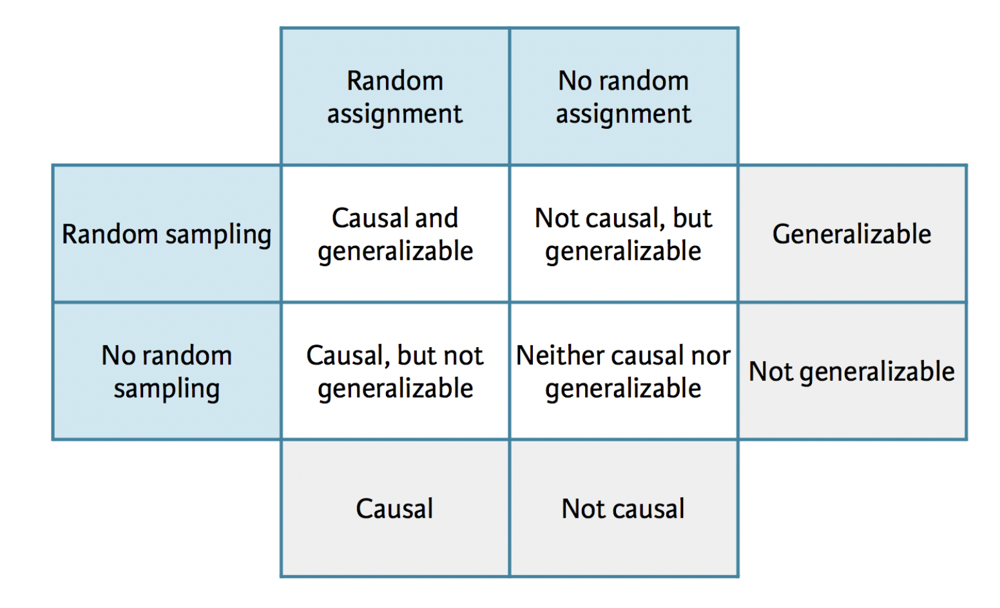
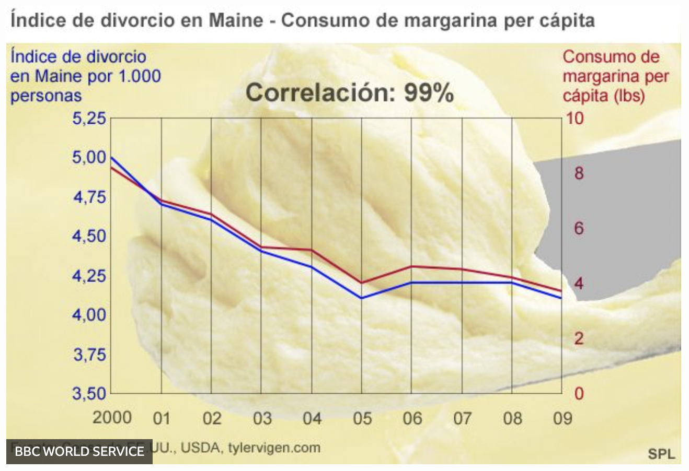
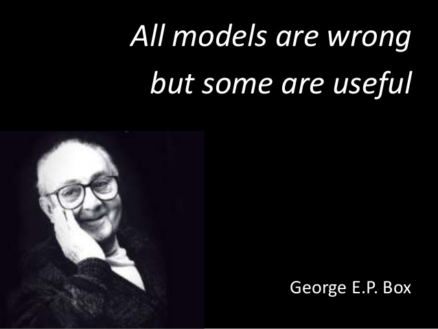

```{r packages_setup, echo=FALSE, message=FALSE, warning=FALSE}
knitr::opts_chunk$set(echo = T, warning = F, message = F)
knitr::opts_chunk$set(fig.width=8, fig.height=4.5, fig.retina=3) 
```

class: center, middle, inverse, title-slide

<div class="title-logo"></div>

# Data Analysis and Information Extraction
 
## Topic 4 - Modeling

<br>

[Linear regression](#regression) &nbsp; · &nbsp; [Optional reading on inference and bootstrap](#optional-inference)

<br>
.pull-left[
### Roi Naveiro
#### Academic Year 2026-2027
]
---
## Modeling

Modeling tools have three fundamental goals:

* **Exploring** the data: models sometimes reveal patterns that are not evident in
visualizations (>3D)

* **Generalizing** findings from a sample to a given population (inference)

* Determining **cause-effect relationships** (causal inference)


```{r, echo=FALSE, out.width = '100%',  fig.align='center'}
knitr::include_graphics("img/data-science-model.png")
library(tidyverse)
library(patchwork)
```
---
## Modeling

How were the observations selected? **Random sampling** helps us generalize from a sample to the population it came from. A voluntary online poll can attract people with particularly strong views.

```{r, echo=FALSE, out.width = '100%',  fig.align='center'}

```

[Source, in Spanish](https://www.huffingtonpost.es/2016/03/28/troleo-en-la-red-para-bautizar-blas-de-lezo-a-un-buque-brita_n_9556114.html)
---
## Study: Cereal Keeps Girls Slim
 
Participants who ate breakfast were observed to have a **lower average body mass index**, a common indicator of obesity, than those who did not eat breakfast. The index was even lower for those who **ate cereal for breakfast**, according to the findings of the **study carried out by the Maryland Medical Research Institute with funding from the NIH and the cereal manufacturer General Mills**.

[...]

The results came from an NIH survey of 2379 girls aged 9 to 19 in California, Ohio and Maryland.

[...]

As part of the survey, participants were asked once a year what they had eaten during the previous three days...

[Source](https://www.cbsnews.com/news/study-cereal-keeps-girls-slim/)
---
## Study: Cereal Keeps Girls Slim

There are three possible explanations for this association between eating cereal and having a lower body mass index:

* Eating cereal is the cause of girls being slim

* Girls being slim is the cause of them eating cereal

* There is a third variable that is the cause of these two, a **confounding variable**

For example, regular eating habits could influence both breakfast choices and body mass index. What additional information would help distinguish these explanations?
---
## Scientific studies

Depending on the data collection process, we distinguish between studies that are:

* **Observational**

  * Data are collected in a way that does not alter the process that generates them

  * They serve to determine **association**

* **Experimental**

  * Individuals are assigned to different treatments

  * Random assignment can support a **causal** interpretation
---
## Scientific studies

```{r, echo=FALSE, out.width = '100%',  fig.align='center'}

```
---
## Correlation does not necessarily imply causation

```{r, echo=FALSE, out.width = '76%',  fig.align='center'}

```
---
name: regression
class: center, middle, inverse

# Models for Exploratory Analysis
---
## What are statistical models?

* Tools that allow us to extract patterns from the data.

* The fitted values describe the pattern. The residuals measure the variation around it.

* We will study models that relate a series of variables (predictor variables)
to a variable of interest (response variable). These are **regression models**.
---
## A model and its parameters

A parametric model describes a family of possible patterns with a few numbers, its **parameters**. The data help us choose values for those numbers.

For a straight line, the two numbers are its intercept and slope. Once we estimate them from a sample, we have a **fitted model**. Other samples can give other estimates.

```{r, echo=FALSE, out.width='48%', fig.align='center'}

```
---
## Vocabulary

* **Response variable**: variable whose behavior or variation we are trying to understand. Also called the dependent variable. y axis.

* **Explanatory variables**: other variables that you want to use to explain the variation in the response. Also called independent variables, covariates, predictors or *features*. x axis.

* **Predicted value**: output of the **model** for a certain value of the covariates.
---
## Working with the examples

```{r}
library(tidyverse)
library(modelr)
head(mtcars[c("wt", "mpg")], 3)
```

Each row is a car. Which variable will we use to predict the other? What sign would you expect for the slope?
---
name: fuel-economy
## Fuel economy and weight

```{r, out.width="78%"}
ggplot(mtcars, aes(x=wt, y=mpg)) + geom_point() + theme_minimal() +
  geom_smooth(method="lm", se=FALSE, color='red')
```
---
## Simple linear regression


* Write the response as $y = \beta_0 + \beta_1 x + \epsilon$, where $\epsilon \sim \mathcal{N}(0, \sigma^2)$

* At a given weight $x$, cars vary around the mean fuel economy $\beta_0 + \beta_1x$.

* The intercept sets the height of the line at zero. The slope gives the change in mean fuel economy per unit of weight.

* In `mtcars`, fuel economy is measured in miles per US gallon and one unit of `wt` is 1,000 lb.
---
## Model assumptions

$$
Y_i \mid X_i=x_i \sim \mathcal{N}(\beta_0 + \beta_1 x_i,\; \sigma^2)
$$

For the usual normal-error model we assume

1. **Linearity**: the expected value of the response variable corresponds to a linear function of the covariate.

2. Independence of the errors.

3. Homoscedasticity: the variance of the errors is constant.

4. Normality: the errors follow a normal distribution.

We will use residual plots to look for curvature and changes in spread.
---
## Fitting models

```{r}
set.seed(4)
models <- tibble(
  a1 = runif(250, -20, 40),
  a2 = runif(250, -5, 5)
)

ggplot(mtcars, aes(wt, mpg)) + 
  geom_abline(aes(intercept = a1, slope = a2), data = models, alpha = 1/4) +
  geom_point() + theme_minimal()
```
---
## Fitting models

* Most of these models are **bad**, they do not capture the pattern

* We need to determine which models are **closer** to the data

* One option: use the model that minimizes the sum of the squared vertical distances
from each point to the model line
---
## Fitting models

```{r, echo=F}
fit <- lm(mpg ~ wt, data = mtcars)
mtcars[,"predicted"] <- predict(fit)

ggplot(mtcars, aes(wt, mpg)) + geom_smooth(method="lm", se=F, color="red") +
  geom_segment(aes(xend = wt, yend = predicted), alpha = .2) +  # alpha 
  geom_point() + theme_minimal()
```
---
## Least squares

* To estimate the values of $\beta_0$ and $\beta_1$, we use the data.

* We call the estimates $\hat{\beta}_0$ and $\hat{\beta}_1$.

* We call $\hat{y} = \hat{\beta}_0 + \hat{\beta}_1 x$ the predicted value.

* $\hat{\beta}_0$ and $\hat{\beta}_1$ are the values that minimize the sum of the squared vertical distances seen above

\begin{equation}
\arg \min_{\beta_0, \beta_1} \sum_{i=1}^n [y_i - (\beta_0 + \beta_1 x_i)]^2
\end{equation}

* In words: among all possible lines, we choose the one for which this sum is smallest.
---
## Fitting the line in R

To obtain the value of the coefficients using R, we do

```{r}
reg_mod <- lm(mpg ~ wt, data = mtcars)
coef(reg_mod)
```

* The object `mpg ~ wt` is a formula. It is equivalent to

$$
\widehat{\text{mpg}} = \hat{\beta}_0 + \hat{\beta}_1 \cdot \text{wt}
$$

* Intercept is the estimate of the coefficient $\beta_0$ and the other number is the estimate of $\beta_1$
---
## Interpreting the fitted line

$$
\widehat{\mathrm{mpg}} = 37.29 - 5.34\,\mathrm{wt}.
$$

* **Slope.** Cars that weigh 1,000 lb more have a predicted fuel economy about **5.34 mpg lower**. A difference of 500 lb corresponds to about 2.67 mpg.

* **Intercept.** The fitted line predicts 37.29 mpg at zero weight. A weight of zero is outside the observed range, so the intercept has little practical meaning here.

.question[What would the model predict for a car weighing 3,000 lb?]
---
name: prediction-residual
## A prediction and a residual

```{r}
predict(reg_mod, newdata = data.frame(wt = 3))
```

The prediction for 3,000 lb is 21.25 mpg. For the first car in `mtcars` (2,620 lb), the model predicts 23.28 mpg. We observe 21 mpg.

$$
e_i = y_i-\hat y_i = 21-23.28 = -2.28\ \mathrm{mpg}.
$$

```{r}
round(resid(reg_mod)[1], 2)
```

The model **overpredicts** fuel economy for this car. A positive residual would mean the model underpredicts it.
---
## Plotting predictions

Create a grid of weights and use the fitted model to predict at each one.

```{r}
grid <- mtcars %>%
  data_grid(wt) %>%
  add_predictions(reg_mod)
head(grid, 3)
```
---
## Observations and fitted values

```{r}
ggplot(mtcars, aes(wt)) +
  geom_point(aes(y = mpg)) + theme_minimal() +
  geom_line(aes(y = pred), data = grid, colour = "red", linewidth = 1)
```
---
## Plotting residuals

```{r, out.width="72%"}
mtcars %>% add_residuals(reg_mod) %>%
  ggplot(aes(wt, resid)) +
  geom_hline(yintercept = 0, colour = "grey60") +
  geom_point() + theme_minimal()
```

Look across the range of weights. A curved pattern suggests the straight line has missed part of the relationship.
---
## Does a curve fit better?

```{r, out.width="68%"}
mod_curve <- lm(mpg ~ wt + I(wt^2), data = mtcars)
mtcars %>% add_residuals(reg_mod, var = "Linear") %>%
  add_residuals(mod_curve, var = "Quadratic") %>%
  pivot_longer(c(Linear, Quadratic), names_to = "model", values_to = "resid") %>%
  ggplot(aes(wt, resid)) + geom_hline(yintercept = 0, colour = "grey60") +
  geom_point() + facet_wrap(~ model) + theme_minimal()
```

Compare the curvature and vertical spread on the same scale. How do the residuals for the lightest and heaviest cars change?
---
## A quadratic term

The formula `mpg ~ wt + I(wt^2)` fits $\hat y=b_0+b_1 x+b_2 x^2$.

* To compare two weights, subtract their fitted values. The change depends on the starting weight.

* The turning point solves $b_1+2b_2 x=0$, so $x^*=-b_1/(2b_2)$. It is a minimum if $b_2>0$ and a maximum if $b_2<0$.

```{r}
b <- coef(mod_curve)
round(unname(-b[2] / (2 * b[3])), 2)
range(mtcars$wt)
```

Is the turning point within the range of weights in our sample?
---
name: salary
## Teachers' salaries

We will use the `teacher` data to model **base salary in dollars** using years of experience and degree. Set MA as the reference level.

```{r}
library(openintro)
library(broom)
data("teacher")
teacher <- teacher %>%
  mutate(degree = factor(degree, levels = c("MA", "BA")))
```

.question[Fit `base ~ years`. Interpret the slope and predict the base salary for a teacher with 15 years of experience.]
---
## Salary and years of experience

```{r, out.width="70%"}
fit_years <- lm(base ~ years, data = teacher)
ggplot(teacher, aes(x=years, y=base)) + geom_point() +
  geom_smooth(method="lm", color='red', se=FALSE) + theme_minimal()
```
---
## Salary and years of experience

```{r}
tidy(fit_years) %>% select(term, estimate)
predict(fit_years, newdata = data.frame(years = 15))
```

Each additional year of experience is associated with about **&#36;803 more** in predicted base salary. The prediction for 15 years is about **&#36;55,715**.
---
## Salary and degree

* What levels does `degree` have? Which did we put first?

* We fit a model

```{r}
mod_base_degree <- lm(base ~ degree, data=teacher)
tidy(mod_base_degree) %>% select(term, estimate)
```
---
## Reading a factor coefficient

R creates `degreeBA`, an indicator equal to 1 for BA and 0 for MA.

* **MA** is the reference group. Its predicted salary is the intercept, **&#36;56,610**.
* **BA** has a predicted salary about **&#36;352 lower** than MA. Add the coefficient of `degreeBA` to the intercept to get the BA prediction.

With three degrees, R would use two indicators. Each compares its group with the same reference group.
---
## Predicting each group mean

```{r}
grid <- teacher %>% 
  data_grid(degree) %>% 
  add_predictions(mod_base_degree)
grid
```
---
## Two fitted group means

```{r}
ggplot(teacher, aes(x=degree)) + geom_point(aes(y=base)) + theme_minimal() +
  geom_point(data = grid, aes(y = pred), colour = "red", size = 4)
```
---
## Multiple Linear Regression

* On many occasions, we have more than one predictor variable.

* The simplest linear model for this case is **multiple linear regression**

\begin{equation}
y_i = \beta_{0} + \beta_1 x_{i1} + \beta_2 x_{i2} + \dots + \beta_p x_{ip} + \epsilon_i
\end{equation}

* Here $x_{ij}$ is the value of predictor $j$ for observation $i$.

* The effects of different covariates on the expected value of the dependent variable are additive.
---
## Salary, experience and degree

Fit both predictors in one model.

```{r}
fit_salary <- lm(base ~ years + degree, data = teacher)
tidy(fit_salary) %>% select(term, estimate)
```
---
## Reading the adjusted coefficients

* **Intercept (&#36;44,838).** Predicted base salary for an MA teacher with zero years of experience.
* **Years (&#36;818).** At the same degree level, one more year of experience is associated with about &#36;818 more in predicted salary.
* **BA (−&#36;2,560).** At the same experience level, the predicted salary for BA is about &#36;2,560 lower than for MA.

.question[The degree-only model gave a gap of about &#36;352. What are you holding fixed in the new comparison?]
---
## Predicting two salaries

```{r}
cases <- tibble(years = c(15, 15), degree = c("MA", "BA"))
cases %>% add_predictions(fit_salary)
```

For 15 years of experience, the predicted salaries are about **&#36;57,108 (MA)** and **&#36;54,548 (BA)**. In this additive model the gap is the same at five years. Why?
---
## A grid for both groups

Use a common grid of years and predict for each degree.

```{r}
grid <- teacher %>% 
  data_grid(years, degree) %>% 
  add_predictions(fit_salary)
head(grid, 4)
```
---
## Observed salaries and fitted lines

Each line joins predictions for one degree. What does the distance between the lines represent?

```{r, out.width="76%"}
ggplot(teacher, aes(years, base, colour = degree)) + 
  geom_point() + 
  geom_line(data = grid, aes(y = pred)) + theme_minimal()

```
---
## What does degree explain?

```{r, out.width="68%"}
teacher %>% add_residuals(fit_years, var = "simple") %>%
  add_residuals(fit_salary, var = "with_degree") %>%
  pivot_longer(c(simple, with_degree), names_to = "model", values_to = "error") %>%
  ggplot(aes(years, error, colour = degree)) +
  geom_hline(yintercept = 0, colour = "grey60") + geom_point() +
  facet_wrap(~ model) + theme_minimal()
```

Look for a systematic difference between degrees before and after adding `degree`. Which pattern over years of experience is still visible?
---
name: log-predictor
## When the predictor is a logarithm

For a model $\hat y=b_0+b_1\log(x)$, compare the two fitted values. If $x$ increases by 10%, the predicted change in $y$ is

$$
b_1\{\log(1.10x)-\log(x)\}=b_1\log(1.10).
$$

* In R, use `log(x)` for the natural logarithm. Any other predictors stay fixed in the comparison.
* For example, if $b_1=20$ dollars, increasing $x$ by 10% changes the prediction by $20\log(1.10)$, or about 1.91 dollars.
---
## What if both variables are logged?

In [Lab 4, Exercise 5](../labs/lab4.html#exercise-5), price and carat are both on a base-two log scale.

```{r}
small_diamonds <- diamonds %>% filter(carat <= 2.5)
fit_log <- lm(log2(price) ~ log2(carat), data = small_diamonds)
unname(2^coef(fit_log)[2])
```

Doubling carat adds one to `log2(carat)`. The fitted `log2(price)` increases by the slope. On the original scale the fitted price is multiplied by $2^{b_1}$, about **3.21** here.
---
name: regression-practice
## Your turn

Use `sim3` from `modelr` in [Lab 4, Exercise 8](../labs/lab4.html#exercise-8).

1. Fit `y ~ x1 + x2` and identify the reference group.
2. Compare two groups at the same `x1`. Give the two predicted values and their difference.
3. Plot the observations and the fitted lines by group. Compare the residuals with those from `y ~ x1`. What pattern does adding `x2` explain?

For more practice, try [Lab 4, Exercises 2–6](../labs/lab4.html#exercise-2) on diamond prices. The remaining slides are [optional reading on inference and bootstrap](#optional-inference).
---
name: optional-inference
class: center, middle, inverse

# Optional reading

## Inference and bootstrap

[Back to regression practice](#regression-practice)

---

## Terminology

.vocab[Population]: group of individuals to be studied

.vocab[Parameter]: numerical quantity derived from the population
(almost always unknown)

If we had data on every unit of the population, we could simply compute
the population parameter and that would be it!

--

**Unfortunately, in general we cannot do this. 
Instead, we work with**

.vocab[Sample]: a subset of our population of interest

.vocab[Statistic]: a numerical quantity derived from a sample


---

## Inference

If the sample is .vocab[representative] (chosen at random from the population of interest), then we can use 
probability and statistical inference to draw
conclusions that are .vocab[generalizable] to the population of interest.


---

## Statistical inference

.vocab[Statistical inference] is the process that allows us, through
data from a sample, to draw conclusions about the population the sample
comes from.

- .vocab[Estimation]: use the sample to estimate a plausible range of 
values of an unknown population parameter

- .vocab[Hypothesis test]: assess whether the observed sample provides evidence 
for or against some claim about the population

We will focus on **estimation**.

---

class: center, middle

# Estimation

---

## We travel to Asheville! 

```{r echo=FALSE,out.width=450, fig.align="center"}
knitr::include_graphics("img/asheville.jpg")
```

**How much should we expect to pay for an Airbnb in Asheville?**


---

## Asheville data

[Inside Airbnb](http://insideairbnb.com/) scraped all the Airbnb listings in 
Asheville, NC, that were active on 25 June 2020.

**Population of interest**: Airbnbs in Asheville with at least ten reviews.

**Parameter of interest**: Average price per guest per night in these 
Airbnbs.


.question[
What is the average price per guest per night of the Airbnb rentals in June 2020, 
with at least ten reviews, in Asheville (zip codes 28801 - 28806)?
]

We have data on the price per guest (`ppg`) for a random sample of 50 Airbnb listings.


---

## Point estimation

A .vocab[point estimate] is a single value computed from the sample 
data to serve as the "best estimate" of the population parameter.

Our point estimate for the average price per guest in the population is 
the mean observed in the sample:

```{r}
abb <- read_csv("data/asheville.csv")
abb %>% 
  summarize(mean_price = mean(ppg))
```

---

## Visualizing our sample

```{r, echo = F, out.width = "80%"}
ggplot(data = abb, aes(ppg)) +
  geom_histogram(binwidth = 25,
                 color = "darkblue",
                 fill = "skyblue") +
  labs(title = "Right-skewed distribution of the price per guest",
       x = "Price per guest per night ($)",
       y = "Count") +
  scale_y_continuous(breaks = seq(0, 20, by = 5)) + 
  ylim(0, 20) +
  theme_minimal()
```

---

## Point estimate?

.question[
If you want to estimate a population parameter, would you rather report a range of values in which the parameter might lie, or a single value?
]


--

- If we only provide a point estimate, we will probably not hit 
the true value of the population parameter exactly.

- If we provide a range of plausible values,
we have a higher probability of capturing the true value of the parameter.


---

class: middle, center

## Confidence intervals

---

## Variability of the sample statistics

To build a confidence interval for the population mean, 
we need to create a range of plausible values around the observed sample mean.

- Remember that random samples can differ from one another. If we took another
random sample of 50 Airbnb listings in Asheville, we would probably not obtain the same
mean price per guest.

--

- There is a certain .vocab[variability] in the sample mean.

- To build a confidence interval, we must quantify this variability. This
gives us a measure of how much we expect the sample mean to vary from
sample to sample.


---

## Quantifying the variability

We can quantify the variability of the sample statistics through different approaches:

- **Simulation**: through techniques such as "bootstrap" or "resampling" (**what we will do here**)

or

- **Theory**: through the Central Limit Theorem

---

class: center, middle

# Bootstrapping

---

## The bootstrap principle


- The term .vocab[bootstrap] comes from the phrase "to pull oneself up 
by one's own 
bootstraps", which is a metaphor for accomplishing an impossible task without 
any outside help.

- In this case, the impossible task is estimating a population parameter, and we 
will accomplish it using data from the given sample only.

- This notion of saying something about a population parameter using 
only information from an observed sample is the essence of statistical inference;
it is not limited to the bootstrap.

---

## The bootstrap procedure

1. Take a .vocab[bootstrap sample] - a random sample drawn **with replacement**
from the original sample, **of the same size** as the original sample.

2. Compute the .vocab[bootstrap statistic]:  the statistic of interest (the 
mean, the median, the correlation, etc.) using the bootstrap sample.

3. Repeat steps (1) and (2) many times to create a .vocab[bootstrap distribution] - a distribution of bootstrap statistics.

4. Compute the bounds of the XX% confidence interval as the region that holds the
central XX% of the bootstrap distribution.

---

## The original sample

<br><br>

```{r, echo = F, out.width = "70%"}
mean0 <- round(mean(abb$ppg),3)
ggplot(data = abb, aes(ppg)) +
  geom_histogram(binwidth = 25,
                 color = "darkblue",
                 fill = "skyblue") +
  labs(caption = paste0("Original sample: mean = ", mean0),
       x = "Price per guest per night",
       y = "Count") +
  scale_y_continuous(breaks = seq(0, 20, by = 5)) + 
  ylim(0, 20) +
  scale_x_continuous(breaks = seq(0, 250, by = 50)) + 
  xlim(0, 250) +
  geom_vline(xintercept = mean(abb$ppg), lwd = 2, color = "red") + 
  theme_minimal()
```

---

## Step by step

**Step 1.** Take a .vocab[bootstrap sample]: a random sample drawn 
**with replacement** from the original sample, **of the same size** as the 
original sample:


```{r, echo = F, out.width = "70%"}
set.seed(1)
indices <- sample(1:nrow(abb), 50, replace = T)
boot_samp_1 <- abb %>% 
  slice(indices)
```

```{r, echo = F, out.width = "70%"}
ggplot(data = boot_samp_1, aes(ppg)) +
  geom_histogram(binwidth = 25,
                 color = "darkblue",
                 fill = "skyblue") +
  labs(caption = "Bootstrap sample 1",
       x = "Price per guest per night",
       y = "Count") +
  scale_y_continuous(breaks = seq(0, 20, by = 5)) + 
  ylim(0, 20) +
  scale_x_continuous(breaks = seq(0, 250, by = 50)) + 
  xlim(0, 250) +
# geom_vline(xintercept = mean(boot_samp_1$ppg), lwd = 2, color = "red") + 
  theme_minimal()
```


---

## Step by step

**Step 2.** Compute the bootstrap statistic (in this case, the sample mean) 
using the bootstrap sample:


```{r, echo = F, out.width = "70%"}
mean1 <- round(mean(boot_samp_1$ppg), 3)
ggplot(data = boot_samp_1, aes(ppg)) +
  geom_histogram(binwidth = 25,
                 color = "darkblue",
                 fill = "skyblue") +
  labs(caption =  paste0("Bootstrap sample 1: mean = ", mean1),
       x = "Price per guest per night",
       y = "Count") +
  scale_y_continuous(breaks = seq(0, 20, by = 5)) + 
  ylim(0, 20) +
  scale_x_continuous(breaks = seq(0, 250, by = 50)) + 
  xlim(0, 250) + 
  geom_vline(xintercept = mean(boot_samp_1$ppg), lwd = 2, color = "red") + 
  theme_minimal()
```

---

## Step by step

**Step 3.** Repeat steps 1 and 2 several times to create a bootstrap distribution 
of sample means:

.pull-left[
```{r, echo = F}
set.seed(1)
temp <- abb %>% slice(sample(1:50, replace = T))
samp1 <- ggplot(data = temp, aes(ppg)) +
  geom_histogram(binwidth = 25, color = "darkblue", fill = "skyblue") +
  labs(x = "", y = "") +
  scale_y_continuous(breaks = seq(0, 20, by = 5)) + 
  ylim(0, 20) +
  scale_x_continuous(breaks = seq(0, 250, by = 50)) + 
  xlim(0, 250) +
  geom_vline(xintercept = mean(temp$ppg), lwd = 1, color = "red") + 
  theme_minimal()
```
```{r, echo = F}
set.seed(2)
temp <- abb %>% slice(sample(1:50, replace = T))
samp2 <- ggplot(data = temp, aes(ppg)) +
  geom_histogram(binwidth = 25, color = "darkblue", fill = "skyblue") +
  labs(x = "", y = "") +
  scale_y_continuous(breaks = seq(0, 20, by = 5)) + 
  ylim(0, 20) +
  scale_x_continuous(breaks = seq(0, 250, by = 50)) + 
  xlim(0, 250) +
  geom_vline(xintercept = mean(temp$ppg), lwd = 1, color = "red") + 
  theme_minimal()
```
]

.pull-right[
```{r, echo = F}
set.seed(3)
temp <- abb %>% slice(sample(1:50, replace = T))
samp3 <- ggplot(data = temp, aes(ppg)) +
  geom_histogram(binwidth = 25, color = "darkblue", fill = "skyblue") +
  labs(x = "", y = "") +
  scale_y_continuous(breaks = seq(0, 20, by = 5)) + 
  ylim(0, 20) +
  scale_x_continuous(breaks = seq(0, 250, by = 50)) + 
  xlim(0, 250) +
  geom_vline(xintercept = mean(temp$ppg), lwd = 1, color = "red") + 
  theme_minimal()
```

```{r, echo = F}
set.seed(4)
temp <- abb %>% slice(sample(1:50, replace = T))
samp4 <- ggplot(data = temp, aes(ppg)) +
  geom_histogram(binwidth = 25, color = "darkblue", fill = "skyblue") +
  labs(x = "", y = "") +
  scale_y_continuous(breaks = seq(0, 20, by = 5)) + 
  ylim(0, 20) +
  scale_x_continuous(breaks = seq(0, 250, by = 50)) + 
  xlim(0, 250) +
  geom_vline(xintercept = mean(temp$ppg), lwd = 1, color = "red") + 
  theme_minimal()
```
]

```{r echo = F, out.width="80%"}
(samp1 + samp2)/(samp3 + samp4)
```

---

## Step by step

**Step 3.** In this plot, we have taken 500 bootstrap samples, computed the
sample mean for each one and represented them in a histogram:

```{r, echo = F, out.width = "70%"}
boot_dist <- tibble(boot_mean = numeric(500))
for(i in 1:500){
  set.seed(i)
  indices <- sample(1:50, replace = T)
  boot_dist$boot_mean[i] <- mean(abb$ppg[indices])
}
ggplot(data = boot_dist, aes(boot_mean)) +
  geom_histogram(binwidth = 5, color = "darkred", fill = "pink") +
  labs(x = "", y = "", title = "Bootstrap distribution of sample means") +
  scale_x_continuous(breaks = seq(0, 250, by = 50)) + 
  xlim(0, 250) +
  theme_minimal()
```


---

## Bootstrap means versus the original data

**Here we compare the bootstrap distribution of the sample means with the distribution of the original data. What do you observe?**

```{r, echo = F}
boot_dist <- tibble(boot_mean = numeric(500))
for(i in 1:500){
  set.seed(i)
  indices <- sample(1:50, replace = T)
  boot_dist$boot_mean[i] <- mean(abb$ppg[indices])
}
p1 <- ggplot(data = abb, aes(ppg)) +
  geom_histogram(binwidth = 25,
                 color = "darkblue",
                 fill = "skyblue") +
  labs(x = "", y = "", title = "Original sample") +
  scale_y_continuous(breaks = seq(0, 20, by = 5)) + 
  ylim(0, 20) +
  scale_x_continuous(breaks = seq(0, 250, by = 50)) + 
  xlim(0, 250) +
  geom_vline(xintercept = mean(abb$ppg), lwd = 2, color = "red") + 
  theme_minimal() +
  theme(axis.title.y=element_blank(),
        axis.text.y=element_blank(),
        axis.ticks.y=element_blank())
p2 <- ggplot(data = boot_dist, aes(boot_mean)) +
  geom_histogram(binwidth = 5, color = "darkred", fill = "pink") +
  labs(x = "", y = "", title = "Bootstrap distribution of sample means") +
  scale_x_continuous(breaks = seq(0, 250, by = 50)) + 
  xlim(0, 250) +
  theme_minimal() +
  theme(axis.title.y=element_blank(),
        axis.text.y=element_blank(),
        axis.ticks.y=element_blank())
p1 / p2
```

---

## Step by step

**Step 4.** Compute the bounds of the bootstrap interval using percentiles of the bootstrap distribution

```{r, echo = F, out.width = "70%"}
boot_dist <- tibble(boot_mean = numeric(500))
for(i in 1:500){
  set.seed(i)
  indices <- sample(1:50, replace = T)
  boot_dist$boot_mean[i] <- mean(abb$ppg[indices])
}
ggplot(data = boot_dist, aes(boot_mean)) +
  geom_histogram(binwidth = 5, color = "darkred", fill = "pink") +
  labs(x = "", y = "", title = "Bootstrap distribution of sample means",
       subtitle = "95% confidence interval bounds") +
  scale_x_continuous(breaks = seq(0, 250, by = 50)) + 
  xlim(0, 250) +
  geom_vline(xintercept = quantile(boot_dist$boot_mean, 0.025), 
             lwd = 1, color = "black") +
  geom_vline(xintercept = quantile(boot_dist$boot_mean, 0.975), 
             lwd = 1, color = "black") +
  theme_minimal()
```

---

class: center, middle

# Bootstrapping in R

---

## The `infer` package

.pull-left[

]

.pull-right[
<br/><br/><br/><br/>
The goal of the infer package is to perform statistical inference using a
grammar that integrates with the tidyverse design framework.

```{r}
library(infer)
```

<br><br>
[infer.netlify.com](http://infer.netlify.com)
]

---

## Choose a seed


```{r}
set.seed(123)
```

The `set.seed()` function is a base R function that allows us to control random number generation in R. Use it to make your simulation reproducible.

In other words, it ensures that we will obtain the same random sample every time we run the code or knit.

---

## Generating bootstrap means

```{r eval=FALSE}
abb %>%
  # specify the variable of interest
  specify(response = ppg) #<<
```

- `specify()` is used to specify which variable in our dataset is the
relevant response variable (that is, the variable on which we are going to do the
bootstrap).


---

## Generating bootstrap means

```{r eval=FALSE}
abb %>%
  # specify the variable of interest
  specify(response = ppg) %>% 
  # generate 15000 bootstrap samples
  generate(reps = 15000, type = "bootstrap") #<<
```

- `generate()` generates the bootstrap means

---

## Generating bootstrap means

```{r eval=FALSE}
abb %>%
  # specify the variable of interest
  specify(response = ppg) %>% 
  # generate 15000 bootstrap samples
  generate(reps = 15000, type = "bootstrap") %>% 
  # calculate the statistic of each bootstrap sample
  calculate(stat = "mean") #<<
```

- `calculate()` computes the sample statistic. In this case we use the mean, but we could compute, for example,
the bootstrap medians.


---

## Generating bootstrap means

```{r include=FALSE}
set.seed(834782)
```

```{r}
num_reps <- 100
```

```{r}
# save resulting bootstrap distribution
boot_dist <- abb %>% #<<
  # specify the variable of interest
  specify(response = ppg) %>% 
  # generate 100 bootstrap samples
  generate(reps = num_reps, type = "bootstrap") %>% 
  # calculate the statistic of each bootstrap sample
  calculate(stat = "mean")
```

---

## Sample means


How many observations are there in `boot_dist`? What does each observation represent?

--

```{r}
boot_dist
```

---

## Visualizing the distribution

```{r echo=FALSE}
ggplot(data = boot_dist, mapping = aes(x = stat)) +
  geom_histogram(binwidth = 5) +
  labs(title = paste0("Bootstrap distribution centered around ", round(mean(boot_dist$stat))),
       x = "Price per guest", y = "Count", caption = "Binwidth of 5") +
  theme_minimal()
```

---

## Computing the confidence interval

A 95% confidence interval contains the central 95% of the bootstrap distribution. To obtain the central 95%, we want to leave out 2.5% on the left and 2.5% on the right.


--

Using `dplyr`:

```{r}
ci <- boot_dist %>%
  summarise(lower_b = quantile(stat, 0.025), 
            upper_b = quantile(stat, 0.975))
ci
```

---

## Visualizing a confidence interval (Option 1)

Using `geom_vline()` to mark the bounds of the confidence interval


```{r eval = F, out.width = "75%"}
ggplot(data = boot_dist, mapping = aes(x = stat)) + #<<
  geom_histogram(binwidth = 5, alpha = .5) +
  geom_vline(xintercept = ci$lower_b, #<<
             color = "steelblue", lty = 2, linewidth = 1) + 
  geom_vline(xintercept = ci$upper_b, #<<
             color = "steelblue", lty = 2, linewidth = 1) +
  labs(title = "Bootstrap distribution of the mean price per guest",
       subtitle = "with 95% CI",
       x = "Means", y = "Count") +
  theme_minimal()
```

---

## Visualizing a confidence interval (Option 1)


```{r echo=FALSE, out.width = "75%"}
ggplot(data = boot_dist, mapping = aes(x = stat)) + #<<
  geom_histogram(binwidth = 5, alpha = .5) +
  geom_vline(xintercept = ci$lower_b, #<<
             color = "steelblue", lty = 2, linewidth = 1) + 
  geom_vline(xintercept = ci$upper_b, #<<
             color = "steelblue", lty = 2, linewidth = 1) +
  labs(title = "Bootstrap distribution of the mean price per guest",
       subtitle = "with 95% CI",
       x = "Means", y = "Count") +
  theme_minimal()
```

---

## Visualizing a confidence interval (Option 2)

```{r eval = F, out.width = "75%"}
visualize(boot_dist) + #<<
  shade_confidence_interval(endpoints = ci)+ #<<
  labs(title = "Bootstrap distribution of the mean price per guest",
       subtitle = "with 95% CI",
       x = "Means", y = "Count") 
```
---

## Visualizing a confidence interval (Option 2)

```{r echo = F, out.width = "75%"}
visualize(boot_dist) + #<<
  shade_confidence_interval(endpoints = ci)+ #<<
  labs(title = "Bootstrap distribution of the mean price per guest",
       subtitle = "with 95% CI",
       x = "Means", y = "Count") 
```
---


## Interpreting a confidence interval

Our 95% confidence interval (CI) is 
(`r round(ci$lower_b, 1)`, `r round(ci$upper_b, 1)`).

.question[
Does this mean that there is a 95% probability that the population mean price per night is contained in the interval (`r round(ci$lower_b, 1)`, `r round(ci$upper_b, 1)`)? 
]

---

class: center, middle

.question[
**No!**
]

---

## Interpreting a confidence interval

- The population parameter either is or is not in our interval. It cannot have a "95% probability" of being in some specific interval.

--

- The bootstrap distribution captures the variability of the sample mean, but it is based on our original sample. If we started with a different sample, our estimated 95% confidence interval  might be different.

--

- All we can say is that, if we took repeated independent samples from this population and computed a 95% CI for the mean in the same way, then we would *expect* 95% of these intervals to contain the population mean.

--

- However, we never know whether any particular interval actually does!

---

## Interpretation 

.question[
**We are 95% confident that the mean price per guest per night for Airbnbs in Asheville, NC is between `r round(ci$lower_b,1)` and `r round(ci$upper_b,1)` dollars.**
]

---
## Theoretical foundations: intuition 

- We assume that our data come from an unknown distribution $F$.  
- From the observed sample, we build the **empirical distribution** $\hat{F}$, which basically assigns the same probability to each observed data point.  
- The **bootstrap** consists of taking many samples with replacement from $\hat{F}$, which, intuitively, “simulates” sampling from $F$ again.  
- By recomputing the statistic of interest on each bootstrap sample, we obtain an approximation of how that statistic would vary if we really took new samples from the original population.

---

## Theoretical foundations: why it works

- **Main idea**: In large samples, $\hat{F}$ gets closer and closer to $F$.  
  - (Law of Large Numbers / Consistency of the empirical distribution).  
- **Consequence**: Sampling from $\hat{F}$ mimics the act of sampling from $F$ well enough.  
- **Bootstrap**:  
  - It generates the **bootstrap distribution** of the estimator, which (under reasonable conditions) approximates the real distribution that estimator would have if we sampled repeatedly from the population.  
  - This approximation makes it possible to estimate standard errors, confidence intervals, etc., **without** knowing $F$ or resorting to complicated formulas.


---

## Theoretical foundations: why it works

**Conclusion**: Even though we are “inventing” data by sampling from $\hat{F}$, it turns out that, when $n$ is large, this procedure is **statistically reliable** and converges to the same answer we would obtain from $F$.


---
## Bibliography

This topic is largely based on  [R for Data Science](https://r4ds.had.co.nz/), Wickham and Grolemund (2016)